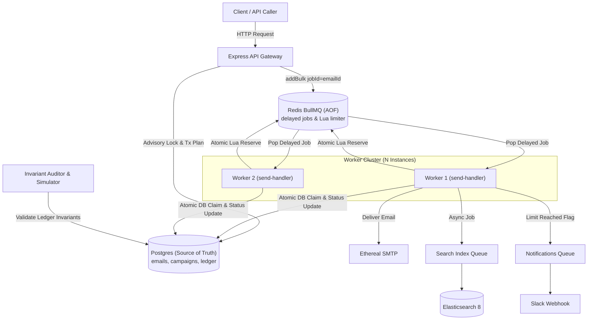

# A Verifiable Email Scheduler

A capacity-planned, crash-resilient cold-email scheduling platform built on Node.js, TypeScript, PostgreSQL, BullMQ, Redis (AOF), and Elasticsearch.

Every guarantee in this system maps directly to a written **invariant**, verified continuously across chaos tests, worker crashes, and virtual-clock multi-day simulations.

---

## 1. Architecture



---

## 2. Quick Start

### Prerequisites
- Node.js 20+
- Docker & Docker Compose

### 1. Boot Infrastructure
```bash
docker compose up -d
```
Starts:
- **PostgreSQL 16**: Port `5434` (mapped from container `5432` to avoid host conflicts)
- **Redis 7 (AOF enabled)**: Port `6379`
- **Elasticsearch 8.13.4 (Single Node, Security disabled)**: Port `9200`

### 2. Install & Configure Backend
```bash
cd backend
npm install
npm run migrate
npm run seed
```

### 3. Start API and Worker
```bash
# Terminal 1: API Server
npm run dev:api

# Terminal 2: Background Worker (start multiple for concurrency testing)
npm run dev:worker
```

### 4. Run One-Command Verification
```bash
npm run verify
```

---

## 3. Milestones & Implementation Progress

- [x] **M0: Foundations** - Monorepo, TS strict, `docker-compose.yml` (Postgres, Redis with AOF, Elasticsearch), Zod `config/env.ts`, pino logger, `/health` and `/ready`, `core/ports.ts`, Prisma schema.
- [x] **M1: Auth (Google OAuth & Test Bypass)** - Google OAuth code flow, JWT in httpOnly cookie + Bearer auth, `/auth/me`, `/auth/logout`, `requireAuth` middleware, test-gated bypass token.
- [x] **M2: Senders (Ethereal test accounts, pool & health)** - Sender CRUD, automated Ethereal test account generation via Nodemailer, AES-256-GCM encryption at rest for credentials, SMTP connection verify & pooling, 3-sender seed script.
- [x] **M3: Event Ledger (Append-only ledger, DB trigger guard, timeline)** - Append-only `email_events` with PostgreSQL trigger blocking UPDATE/DELETE, atomic `withLedger` transactional helper, `GET /api/emails/:id/timeline` with plain-English summary.
- [x] **M4: Pure Capacity Planner (First-fit, advisory lock, deterministic jitter, fast-check tests)** - Pure timeline allocator, round-robin across healthy senders, clock-hour cap & min-gap enforcement, seeded jitter, preview calculations, fast-check property verified (10k emails in <1s).
- [x] **M5: Schedule and Preview APIs (Chunked transaction, idempotency key)** - `POST /api/campaigns/preview` and `POST /api/campaigns` supporting JSON & CSV upload, sender advisory lock serialization, chunked insert, BullMQ delayed job enqueue (1:1 matching), `Idempotency-Key` protection.
- [x] **M6: Send Handler & BullMQ Worker (Two-layer idempotency, atomic DB claim, error classification)** - Pure domain `handleSend` function behind ports, atomic `UPDATE ... RETURNING` DB claim, deterministic Message-ID, transient/permanent SMTP classification.
- [x] **M7: Atomic Lua Limiter (Fixed & sliding strategies, rank overflow rescheduling, no sleep)** - Atomic Redis Lua script with external `now`, rank-based overflow rescheduling without dropping jobs or burning attempts, `DelayedError` integration.
- [x] **M8: Persistence & Boot Reconciler (AOF recovery, stale PROCESSING reclamation)** - Boot-time and on-demand `POST /admin/reconcile` reconciler, re-enqueues missing BullMQ jobs from PostgreSQL, reclaims abandoned stale `PROCESSING` rows with `RECOVERED` event.
- [x] **M9: Invariant Auditor (7 mathematical invariants, corruption proof)** - CLI `npm run audit` and `GET /admin/audit` asserting: at-most-once delivery, hourly rate limits, minimum gaps, zero lost emails, no early sends, monotonic reschedule order, and store agreement. Proven against corrupted datasets.
- [ ] **M10: Simulator, Chaos & Load Evidence (`tools/simulate.ts`, `tools/chaos.ts`, `tools/load.ts`)**
- [ ] **M3: Event Ledger (Append-only ledger, DB trigger guard, timeline)**
- [ ] **M4: Pure Capacity Planner (First-fit, advisory lock, deterministic jitter, fast-check tests)**
- [ ] **M5: Schedule and Preview APIs (Chunked transaction, idempotency key)**
- [ ] **M6: Send Handler & BullMQ Worker (Two-layer idempotency, atomic DB claim, error classification)**
- [ ] **M7: Atomic Lua Limiter (Fixed & sliding strategies, rank overflow rescheduling, no sleep)**
- [ ] **M8: Persistence & Boot Reconciler (AOF recovery, stale PROCESSING reclamation)**
- [ ] **M9: Invariant Auditor (7 mathematical invariants, corruption proof)**
- [ ] **M10: Simulator, Chaos & Load Evidence (`tools/simulate.ts`, `tools/chaos.ts`, `tools/load.ts`)**
- [ ] **M11: Sender Circuit Breaker & Failover**
- [ ] **M12: Elasticsearch Indexing & Full-Text Search**
- [ ] **M13: Slack OAuth & Limit Notifications**
- [ ] **M14: Operations, Bull Board, Prometheus Metrics (`/metrics`, `/api/stats`)**
- [ ] **M15: Demo-as-Code & Hardening**
